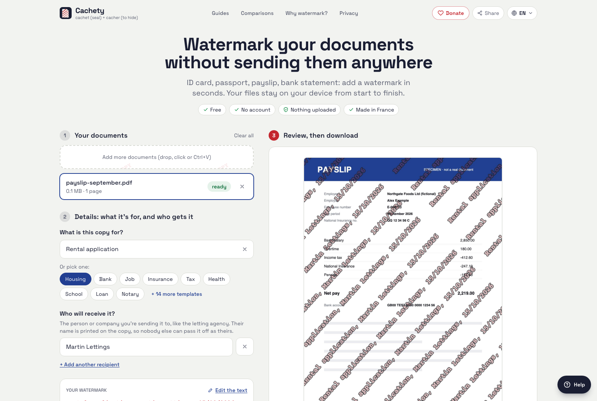

# Cachety

[English](README.md) · [Français](README.fr.md) · [Español](README.es.md) · [Português](README.pt.md) · [Deutsch](README.de.md) · [Nederlands](README.nl.md) · [Bahasa Indonesia](README.id.md) · [العربية](README.ar.md) · [فارسی](README.fa.md) · [日本語](README.ja.md) · **简体中文**

**给身份证和敏感文件加水印，文件始终不离开您的设备。**

Cachety 可以给 PDF 和照片（身份证、护照、工资条、税单、银行流水等）加水印，所有处理都在您的浏览器里完成。文件从不上传：网站根本没有能接收文件的服务器。免费、无需注册、没有跟踪，而且开源。

### 👉 立即使用：**[cachety.com](https://cachety.com)**

支持语言：English、Français、Español、Português、Deutsch、Nederlands、Bahasa Indonesia、العربية、فارسی、日本語 和 简体中文。



## 为什么要做这个工具

租房、入职、开银行账户，我们经常被要求提供证件复印件。复印件一旦发出去，如果什么都没写，就可能被拿去做任何事，包括冒用身份。在水印上写明这份复印件的用途、交给谁、日期，它就只能用于这一次。法国官方的网络犯罪援助平台 [Cybermalveillance.gouv.fr](https://www.cybermalveillance.gouv.fr) 推荐的正是这种做法。

大多数在线加水印工具，都要先把您的身份证上传到它们的服务器。Cachety 不会。

## 推荐使用在线版：这是最好的方式

不需要安装，也不需要自己构建。我们向所有人推荐使用 **[cachety.com](https://cachety.com)**：

- **同样私密。** 即使在线使用，文件也不会离开您的设备：所有工作都由页面在浏览器里完成，而且从技术上禁止它向任何地方发送数据。您可以亲自验证：打开页面，开启飞行模式，再给文件加水印。
- **防护更周全。** 官方网站配齐了全套安全响应头（防点击劫持、HSTS、跨源隔离、每个页面单独设置的严格 Content-Security-Policy）。在普通 Web 服务器上自己搭的副本，常常会漏掉其中一些。
- **始终是最新版。** 安全修复和功能改进，下次打开时自动生效，无需任何更新操作。
- **到哪里都快。** 通过全球 CDN 分发，无论身在何处都能快速打开；加载一次后，断网也能用。
- **任何设备都好用。** 电脑、iPhone 和安卓都能用。可以像 App 一样添加到主屏幕；在安卓上，还能把文件直接分享给 Cachety。
- **自带帮助。** 首次访问时有引导教程告诉您从哪里开始，还有实用指南讲解常见场景。

当然，自行部署也完全可行并得到正式支持（见下文），适合有此需要的机构。

## 功能

- **PDF 和图片：** JPG、PNG、WebP、GIF、BMP、AVIF 以及 iPhone 照片（HEIC）。可以处理单个文件，也可以一次处理多个（每个文件最大 200 MB，PDF 最多 500 页）。
- **整页水印**，融入图像本身。仅仅编辑 PDF 是删不掉的，而且每份副本的排布都不一样。可以选择字体、大小、颜色、透明度和波浪效果。
- **现成模板**（租房、银行、求职等），以及一键「添加今天日期」按钮。
- **清除隐藏数据：** 可选中的文字、元数据和照片的 GPS 位置。每一页都从像素重新生成。
- **遮盖（打码）：** 遮住银行账号、税号或照片。内容会被真正删除，而不只是盖住。
- **可追溯副本：** 每份副本都带有日期和唯一编号，另有一份由您自己保存的副本记录。
- **多个接收方：** 为每个接收方生成一份专属版本（最多 20 个），一次下载。
- **密码保护：** AES-256 加密 PDF（PDF 2.0），附带强密码生成器，并会自动清除剪贴板。
- **限制文件大小**（1、2、5 或 10 MB），适合有上传限制的网站。
- **合并成一个 PDF**，顺序可拖放调整；也可以打包成 **ZIP**。
- **手机也能用**，可以作为 App 安装，加载一次后**离线**也能用。
- **11 种语言**，阿拉伯语和波斯语采用从右到左的排版，每种文字都配有专用字体。
- **引导帮助教程**，在首次访问者似乎不知从何下手时出现。
- **70 篇实用指南**，覆盖法国、英国、德国、荷兰、西班牙和拉丁美洲、巴西、印度尼西亚、阿拉伯世界、伊朗、日本和中国的日常场景。
- **71 篇经过事实核查的对比文章**，对比其他水印工具（FiligraneFacile、iLovePDF、Smallpdf、PDF24、Adobe Acrobat 等），附有资料来源，也会写明什么时候其他工具更合适。

## 从设计上保护隐私，而且可以验证

- 所有处理都在浏览器中进行（pdf.js、canvas、pdf-lib）。文件只以 `File`/`Blob` 对象的形式存在于内存中。
- Content-Security-Policy 设置了 `connect-src 'self'`，因此即使有恶意代码意外运行，浏览器本身也会拒绝向其他域名发出任何请求。
- 没有 Cookie、没有访问统计、没有第三方脚本、没有账号。`localStorage` 中只保存显示偏好。字体也由本站自己提供。
- 每一项承诺都由自动测试把关，每次修改都会运行：CSP、不存在外部资源、输出文件的净化，以及一次模拟的数据外传尝试。

完整的威胁模型、防护措施和测试：**[docs/security.md](docs/security.md)**。如需报告安全漏洞，请见 **[SECURITY.md](SECURITY.md)**。

## 自行部署

您不必信任我们的部署：网站是一个静态导出，您可以自己托管。

前提条件：[Bun](https://bun.sh)。

```sh
git clone https://github.com/cachety/cachety
cd cachety
bun install
bun run build      # static export in out/
bunx serve out     # or any static file server
```

`out/` 可以原样放到任何静态托管服务上。每个页面都在 `<meta>` 标签中自带 Content-Security-Policy，所以即使没有我们的 HTTP 响应头，网络封锁依然有效。如果想获得和 cachety.com 一样的防护，还需要设置 `out/_headers` 中的响应头。Cloudflare Pages、GitHub Pages 和其他服务器的部署方法，请见 [docs/deploy.md](docs/deploy.md)。

## 开发

```sh
bun run dev        # development server
bun test           # unit tests and static security checks
bun run test:e2e   # browser suite (CHROMIUM_EXE=/path/to/chrome to use a local Chrome)
```

技术栈：Next.js（静态导出）、React、Tailwind CSS、PDF.js、pdf-lib、libheif。

- 界面文字：`lib/i18n.tsx`（法语、英语、日语、中文）和 `lib/locales/<lang>/strings.ts`（其他语言）。
- 网站文案：`lib/site-copy.ts` 和 `lib/locales/<lang>/site.ts`。页面元数据：`lib/site-meta.ts` 和 `lib/locales/<lang>/meta.ts`。
- 指南：`lib/guides/<lang>.ts`。
- 对比页面（「Cachety vs X」）：`lib/compare/<lang>.ts`。关于其他工具的每一条说法都必须注明来源（`sources`）和核实日期（`checked`），每个页面都必须写明什么时候其他工具更合适。请定期重新核实这些信息：服务是会变的。
- 从右到左的语言使用 Tailwind 的逻辑类（`ms-`、`pe-`、`start-`、`end-` 等），而不是 `ml-`、`pr-`、`left-`、`right-`。

所有语言都必须保持相同的结构，测试会检查这一点。

## 支持本项目

Cachety 免费，并将一直免费。如果它帮到了您，可以[在 GitHub Sponsors 上支持它](https://github.com/sponsors/amirhmoradi)。捐助可以帮忙支付域名和开发工具的费用，更重要的是支持投入其中的时间。

目前没有任何广告。将来本项目可能会展示少量精心挑选、理念一致的赞助链接（加密工具、开源软件、安全的文件分享服务）。这些链接的规则非常严格，也是隐私承诺的一部分：

- 明确标注为赞助内容；
- 由 Cachety 自己的域名提供（仅限图片和链接）：不使用广告联盟、第三方脚本或跟踪像素；
- 绝不会根据用户在工具中输入的任何内容来挑选或展示；
- Content-Security-Policy 保持和现在一样严格（`connect-src 'self'`）。

## 致谢与许可

Cachety 是一个个人项目，由 **[Amir Moradi](https://amirmoradi.com)** 在法国设计和维护。

它是 Hugo Sibony（KazeTachinuu）的 **[Filigrane Local](https://github.com/KazeTachinuu/filigrane-local)** 的修改版本。而该项目本身又是受 CyberClarence 的 **[Filigraneur](https://github.com/cyberclarence/filigraneur)** 启发而重写的。感谢两位。详情请见 [NOTICE](NOTICE)。

本项目采用 **GNU Affero General Public License v3.0** 许可（[LICENSE](LICENSE)）。如果您将修改后的版本作为服务运行，AGPL 要求您向用户提供其源代码。
